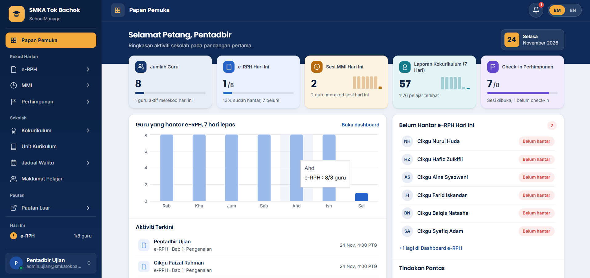

# SchoolManage

A day-to-day operations system for SMKA Tok Bachok that replaces a scattered set of Google Forms,
Looker Studio dashboards, and shared Drive folders with one login-based web app. Teachers submit
their daily records (lesson plans, class check-ins, assembly attendance, co-curriculum reports)
from any device, and admins get live dashboards instead of manually collating spreadsheets.

Built with **React + Vite** on the frontend and **Firebase** (Auth + Firestore) as the backend, so
it deploys as plain static files to any cPanel hosting plan (e.g. Shinjiru), with no Node.js server
required on the host. Every collection is scoped by `schoolId` in the security rules, so the data
model is already safe to host more than one school on the same project, even though today it runs
for a single school.



## Routing structure

- `/`: public marketing landing page (no login needed)
- `/login`: sign-in / registration (Google Sign-In or email + password)
- `/app`: the logged-in system (dashboard + every module below), protected by auth

## Local test mode (no Firebase needed)

With no `.env` file present, the app automatically runs in **local test mode**: sign-in is a
simple name + role picker (no Google account needed), and all data is stored in your browser's
`localStorage` instead of Firestore. This lets you click through every module end-to-end with zero
setup: submit e-RPH, log an MMI check-in, generate an assembly code and check in.

- Sign in as different names to simulate different teachers (each name gets its own local
  account); pick "Pentadbir" as the role to see the admin dashboards.
- To test a long list, open **Maklumat Pelajar**, filter **TINGKATAN 1** + **HAFS** and press
  **Tapis**: that test class has 50 students.
- To run test mode while a real `.env` exists, start Vite with blank Firebase keys, e.g. a
  `.env.localtest.local` file with empty `VITE_FIREBASE_API_KEY=` / `VITE_FIREBASE_PROJECT_ID=` and
  `npx vite --mode localtest`.
- Data persists across page reloads (it's in `localStorage`) but is **per-browser**: it won't
  sync between devices, and clearing browser data wipes it.
- A "Mod Ujian Tempatan" badge shows in the header whenever this mode is active.
- Once you fill in `.env` with real Firebase config (see below), the app switches to real
  Google Sign-In and Firestore automatically. Nothing in the code needs to change.

## What's included

- **Sign-in** via Google (restricted to your school's email domain) or email + password
  registration, both funnelling into the same teacher/admin account model
- **e-RPH**: daily lesson-plan submission (teacher form) plus an admin dashboard (who has/hasn't
  submitted today, 7-day trend chart, search & export)
- **MMI classroom check-in**: teachers log each teaching session (subject, form/class, time,
  student attendance) plus an admin dashboard (sessions by subject, per-teacher roster, average
  attendance)
- **Perhimpunan (SiKAP) assembly check-in**: admin generates a daily code, teachers check in with
  their position and attendance status, and the admin sees a live list with a status breakdown
- **Kokurikulum**: 5 pages, a standalone attendance log for advisor teachers, and a full meeting
  report form (perjumpaan number, date, venue, activity, unit, summary, multiple advisor teachers,
  up to 5 photos) for each of the 4 categories (Badan Beruniform, Kelab & Persatuan, Sukan &
  Permainan, Rumah Sukan), plus an admin dashboard filterable by category
- **Jadual Waktu**: weekly teaching timetable with two views (by class, by teacher), automatic
  clash detection when adding a slot, and Excel/PDF export of the full grid
- **Unit Kurikulum**: subject/department reference hub; admins can attach a Google Drive folder
  link to each subject inline, everyone else sees "Buka Folder" once it's set, plus a Pautan Luar
  menu for the school's other external sites
- **Maklumat Pelajar**: admin-only student records (add, edit, delete, search, filter by form and
  class)
- **Profil**: full teacher record (contact info, employment details, subjects/classes taught,
  qualifications) with photo upload, in-place password change, and PDPA consent tracking
- **Notifikasi**: in-app notification feed (e.g. "so-and-so submitted e-RPH") targeted by role or
  by user, with a read/unread bell in the topbar
- **Developer Controls** (Profil, developer account only): a system-wide kill switch to instantly
  lock every other signed-in user out during maintenance, and a one-click sample-data seeder that
  tops up every collection with realistic demo records for screenshots/testing

## Not yet built

The **Tahfiz/Quran-memorization tracking portal (TMUATB)**, covering individual hafazan records,
halaqah groupings, khatam certification and monthly performance, remains from the school's
original link-in-bio page and hasn't been built here. The data model (Firestore + role-based,
`schoolId`-scoped rules) is set up so it can be added as new collections and pages without
restructuring anything already built.

## 1. Create your Firebase project

1. Go to [Firebase Console](https://console.firebase.google.com/) → **Add project**.
2. Once created, go to **Build → Authentication → Sign-in method** → enable **Google**.
3. Go to **Build → Firestore Database** → **Create database** → start in **production mode**.
4. Go to **Project settings → General → Your apps** → click the **Web** icon (`</>`) to register
   a web app → copy the `firebaseConfig` values shown.

## 2. Configure the app

```bash
cp .env.example .env
```

Fill in the Firebase values you just copied, plus:

- `VITE_ALLOWED_EMAIL_DOMAIN`: only Google accounts ending in `@yourdomain` can sign in
  (e.g. `smkatb.edu.my`). Leave blank to allow any Google account (not recommended).
- `VITE_SCHOOL_NAME`: shown on the login screen and sidebar.

## 3. Set the Firestore security rules

Open **Firestore Database → Rules** in the Firebase Console, paste in the contents of
[`firestore.rules`](firestore.rules) from this project, and click **Publish**. (No Firebase CLI
needed.)

## 4. Run it locally

```bash
npm install
npm run dev
```

## 5. Make yourself an admin

Everyone who signs in for the first time is created with role `guru` (teacher). This is
enforced by the security rules so nobody can grant themselves admin from the app itself.

To promote someone to admin: sign in with that account once, then in the Firebase Console go to
**Firestore Database → Data → `users` collection**, find their document (matches their email),
and change the `role` field from `guru` to `admin`.

## 6. Deploy to cPanel (Shinjiru or similar)

```bash
npm run build
```

This produces a `dist/` folder of static files (including the `.htaccess` needed for the app's
routing to work on Apache). Upload the **contents** of `dist/` (not the folder itself) into
`public_html` (or a subfolder if you want it at `yourschool.com/system`) via cPanel's File
Manager or FTP. That's it: no Node.js, no database server, and no build step needed on the
host itself, since Firebase handles auth/data/storage remotely.

## Notes

- **Composite indexes**: a couple of queries (e.g. "my e-RPH history", filtered by teacher +
  sorted by date) need a Firestore composite index. The first time you use a feature that needs
  one, Firestore will throw an error in the browser console containing a direct link. Click it,
  then click **Create Index** on the Firebase Console page it opens, wait ~1 minute, then retry.
  This only has to be done once per query shape, not per user.
- **Bundle size**: the production build is ~1.1MB (mostly the Firebase SDK), fine for an internal
  staff tool on any connection and not worth optimizing for this MVP.

## Tech stack

- React 19 + Vite
- React Router v7
- Firebase (Auth + Firestore)
- Recharts (dashboard charts)

## Project structure

```
src/
  lib/            firebase.js (SDK init), db.js (Firestore/localStorage switch), constants.js
                  (subjects/classes/time slots/schools), seedProduction.js (sample-data seeder)
  context/        AuthContext.jsx (sign-in, role, session), NotificationContext.jsx
  components/     Layout.jsx (sidebar/topbar shell), ProtectedRoute.jsx
  pages/
    Login.jsx, Home.jsx, Profile.jsx, Help.jsx, Notifications.jsx
    erph/         SubmitERPH.jsx, ERPHDashboard.jsx
    mmi/          SubmitMMI.jsx, MMIDashboard.jsx
    assembly/     CheckIn.jsx, AssemblyAdmin.jsx
    coco/         CocoAttendance.jsx, SubmitCocoUnitReport.jsx (shared by all 4 categories),
                  CocoDashboard.jsx
    curriculum/   Curriculum.jsx
    timetable/    TimetableView.jsx (shared by student/teacher views)
    students/     StudentList.jsx
firestore.rules
firestore.indexes.json
```
